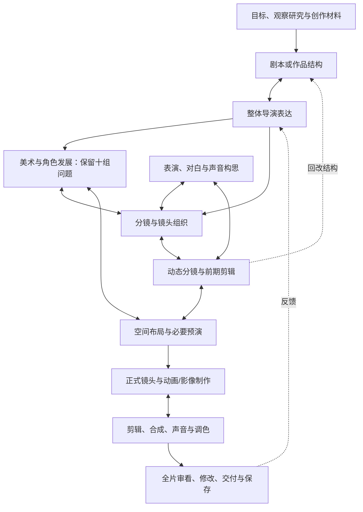

# 全流程衔接与遗漏审查：明确补回分镜

2026-10-22。用户认可美术十组问题，要求保留，并从项目开端到当前复查有无遗漏，尤其分镜。本轮补完整体关系与学习安排，不开始绘制具体作品的分镜或扩大成所有工种的细节教程。

## 审查结论

美术十组问题保留。它是一张专业研究地图，不等于整部影视作品从开发到交付的全部流程。分镜应明确作为导演、剧作、美术、表演、声音与剪辑共同推进的环节，既与美术A07衔接，又不能完全归进美术。

核对旧[执行工作表](../../notes/director-execution-v2.md)、[影视创作方法C01—C12](../../skills/film-creation/SKILL.md)、整体表达与美术规划后，发现旧文件已写分镜最小字段、动态分镜、粗剪和交付。声音、表演、制片及备份也已有条目。因此不能说此前从未考虑它们；本次主要失误是没有把已有内容接回当前主路线，且“有方法条目”尚未成为可执行的连续安排。

## 一张全流程关系图

下图用于当前数字影像、动画方向的总体理解。各阶段可往返，文字与分镜也可共同发展；美术和声音均不必等到剧本/分镜完全锁定才参与。

制片、资产与版本管理贯穿图中各阶段。图中并非每个框都要求独立工程或独立人员：小项目可以合并；Previs与Layout在一些流程中重叠。实验影像可用材料、声画、节奏草稿发展结构；纪录工作须依现场与素材实际情况安排，不要求先虚构一个完整故事再照图实现。

## 哪些方向需要补充或恢复明确位置

| 环节 | 当前问题的性质 | 补清什么 | 当前真实状态 |
| --- | --- | --- | --- |
| 分镜与镜头组织 | 旧方法有，当前美术主路线未显式安排 | 观看位置、画面先后、行动/反应、空间、声画与镜头衔接；不只按对白配图 | 有旧分镜相关研究、执行字段和局部文字方案；不是已完成新作品分镜 |
| 动态分镜与前期剪辑 | 曾提到，但未形成明确桥梁 | 将粗图按时间剪接，加入需要的临时对白、声音或音乐，先听看整段及全片的节奏 | 没有本轮新剧本的完整带声动态分镜；旧几何人GIF不能替代 |
| Layout/空间调度与必要预演 | 藏在美术、摄影、动画接口中 | 核对人物、环境、道具、相机与动作怎样在空间和相邻镜头成立 | 有流程文字与局部模型尝试，尚无适用于完整作品的布局验证 |
| 表演、声音/配音与音乐 | 已有独立方向，被近期美术讨论挤到背景 | 角色怎样行动、声音怎样塑形，临声、音乐关系与正式表演怎样影响图像和时间 | 有文字研究与微练习；无完整数字表演/正式声音成果 |
| 场景拆解、资产与制片 | 资源原则已有，具体跨阶段交接偏弱 | 作品实际需要哪些角色、场景、道具、声音、效果与镜头，怎样安排依赖、资源和修改 | 尚未为新的完整作品建立资产、镜头、版本和排期对应 |
| 正式动画与影像制作 | 不能只由美术和VFX接口代替 | 从设计和预演走向可用镜头；二维、三维、定格、生成、实拍或混合按作品需要安排 | 未用本轮框架完成正式作品；工具或局部编码测试不是该环节完成 |
| 剪辑、声音后期与调色合成 | 旧C08/C09/C11/C12已有，不能只作接口名称 | 持续调整整体结构、节奏、声画、图层与色彩，回到完整观看 | 尚无本轮完整粗剪、混音、调色或成片验证 |
| 全片审看、反馈与交付 | 早有要求，仍需保持在主路线终点 | 完整观看与实听、问题回改、合适规格、字幕署名、素材来源和工程保存；按作品用途决定交付方式 | 未有经用户认可的完整原创作品，不把资料归库当成成片交付 |

前面的目标与研究、剧作、导演总体构思也保留。原六组社会观察与编剧计划继续，现有研读和练习按状态接续；这张图不取消它们，也不恢复已取消剧本或比赛。

摄影与镜头语言同样保留独立的研究位置：分镜是运用和检验观看选择的一种工作方式，不能由“有分镜图”推定已经掌握摄影、构图、运动或剪辑。角色、环境与声音资产的开发也可在预演前及预演中参与，图示并不要求等布局结束后才开始全部资产制作。

## 分镜、动态分镜、预演、布局与清单分别起什么作用

| 名称 | 主要回答什么 | 不能据它单独宣布什么 |
| --- | --- | --- |
| 分镜/故事板 Storyboard | 观众看哪些画面、按什么次序看，角色怎样行动与回应，镜头怎样衔接 | 静态图本身不能证明节奏、声音或最终画面成立 |
| 动态分镜 Animatic/Story Reel | 粗图、时间与必要临声组合后，连续观看怎样工作；有时也用于继续发展故事 | 不要求全都流畅动画，也不是正式动画或最终声音 |
| 预演 Previs | 有必要时用简化影像检查动作、调度、相机、空间或复杂场段 | 不是每个作品都需另做3D预演，也不能只验证坐标便称表达有效 |
| 布局 Layout | 将角色、环境、道具和镜头的具体空间关系落实；不同二维/三维流程做法不同 | 名称或文件不保证视觉语言、表演或连续性已经成立 |
| 镜头清单/镜头任务 | 让需要制作或拍摄的镜头与工作安排可追踪 | 清单不能替代分镜叙事、空间和实际观看判断 |

这些按功能区分，名称可能重叠，不能机械变成五个必经独立工序。分镜也未必一格等于一个镜头，一个镜头可以有多格说明变化。本项目后续按问题需要选用，不能以文件齐全冒充创作完整。

## 对现有学习顺序的补充

**保留美术十题，增加一条“剧本到连续影像”的衔接路线。** 在美术总构思与案例研究中同时辨认：案例的分镜、画面发展、临声/前期剪辑与空间布局怎样与设计相互影响。随后把分镜与动态分镜作为明确的研究方向，按需要接到Layout/预演及具体镜头生产，不跳过中间判断直接批量制作。

本轮查漏只修订总体关系与接续安排，不立即制作逐镜头表。后续研究与创作可以按当前问题交错推进，不以学完全部专题和候选片单为创作前置。进入具体作品时，根据已有剧本和整体提案选择一段能代表全片关键问题的连续段落，逐步形成能听看的预演并放回全片，再按需要展开镜头细节。

声音与表演、制片与资产、剪辑与交付各保留独立学习位置。研究优先级依当前问题调整，不能因为美术范围庞杂，就让它代替整部作品。

## 跨阶段版本对应：这次需要补实的一点

将来每次具体项目交接，应知道当前使用哪一版剧本/结构、整体提案、美术依据、分镜、声轨、镜头和剪辑；修改会影响哪些后续材料。可以是一张轻量对应记录，不要求先搭管理软件。

出现不一致时查清是故意改写、等待更新还是制作失误，再决定回改哪一步。资产清单有字段、工程能打开、格式通过，都不能代替连续内容与观看效果检查。

## 专业资料核对与范围

- [Disney Story](https://www.disneyanimation.com/process/story/)：公开正文已读/复用，涉及分镜与叙事、表演、时间、调度和构图；未看示例图片。
- [Disney Layout](https://www.disneyanimation.com/process/layout/)：公开正文已读/复用，说明由剪接的故事板进入空间布局并反复修改；不能把其3D流程硬套所有媒介。
- [Disney Editorial & Sound](https://www.disneyanimation.com/process/editorial--sound/)：本轮实读正文，涉及剪辑从前到后参与、对白及临时声轨与正式声音工作的关系。
- [ScreenSkills Storyboard Artist](https://www.screenskills.com/job-profiles/browse/animation/pre-production/storyboard-artist/)：本轮实读职责及技能/协作相关正文，核对连续画面和剪辑接口；就业课程建议不作本项目任务。
- [ScreenSkills动画制片管理](https://www.screenskills.com/job-profiles/browse/animation/production-management/production-manager-animation/)：本轮实读职责与协作段，核对排期/流程管理与主流程的关系；不以公司岗位数要求用户配齐团队。
- [Disney Post Production](https://disneyanimation.com/team/post-production/)：本轮实读短正文，核对图像与声音最终交付的衔接。

其他布局、预演职责页面的阅读由分工报告另记。旧执行表和C01—C12是项目已有工作依据，不是外部新资料。各公司岗位命名与流程只是参考，本轮形成的是适合当前项目的功能地图。

分工新增实读的职责正文为：[ScreenSkills动画Layout](https://www.screenskills.com/job-profiles/browse/animation/production/layout-artist-animation/)的功能、二维/三维与协作段，以及[VFX Previs](https://www.screenskills.com/job-profiles/browse/visual-effects-vfx/pre-production/previsualisation-previs-artist/)的内容、技能与协作段，均未读成完整培训课程或看视频。前者将Previs列为别名，提示本规划按功能衔接，不按术语数量累加工序。

## 审查与完成范围

根agent搜索旧资料并实际读取工作表的通用部分、C01—C12、整体表达和美术主框架；两名子agent分别检查全流程遗漏与分镜/预演的功能区分。原报告在本地`新工作/影视全流程遗漏审查-20261022/agents/`。本次能确认的是显式衔接和学习安排需要补足，不能由这些文字宣布整个影视流程无遗漏或已能熟练执行。

本轮产物是全流程图、遗漏类型、环节位置和接续修订。未绘新分镜、制作动态分镜、软件工程或成片，也没有把本次查漏变成提前制作任务。

2026-10-23接续收尾：落实独立复审两项意见，图中加入动态分镜回改剧本/结构的路径，明确研究与创作可以交错，不将完成全部专题和片单设为创作前提。之后按用户授权继续首组美术研读。
